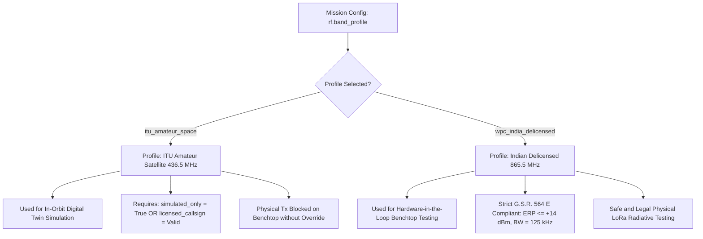

# DOOMSat RF Regulatory Compliance & Frequency Plan

**Document ID:** DOOM-RF-001  
**Revision:** 1.0  
**Status:** Approved Baseline  
**System:** DOOMSat 1U CubeSat Mission Simulator & Digital Twin  
**Jurisdiction Reference:** India (WPC / DoT) & International (ITU / IARU)  

---

## 1. Regulatory Context & Core Mandate

In strict adherence to the project engineering rule:
> **"Do not assume Indian RF frequency authorisation."**

Operating any wireless radio transmitter (including Semtech SX1276 LoRa transceivers) in India is legally governed by the **Indian Telegraph Act, 1885** and the **Indian Wireless Telegraphy Act, 1933**, administered by the **Wireless Planning & Coordination (WPC) Wing** under the **Department of Telecommunications (DoT), Ministry of Communications, Government of India**.

---

## 2. Spectrum Analysis: India vs. International

### 2.1 The 430–440 MHz UHF Band
- **International Amateur Satellite Service (ITU):**
  - Under ITU Radio Regulations Article 5 (RR 5.282), the frequency band **$435.0 - 438.0\text{ MHz}$** is allocated to the **Amateur-Satellite Service** on a secondary basis worldwide (Regions 1, 2, and 3).
  - Standard CubeSat missions operate downlinks/uplinks within $435 - 438\text{ MHz}$ after formal frequency coordination with the **International Amateur Radio Union (IARU)**.
- **Indian National Frequency Allocation Plan (NFAP-2022):**
  - In India, the $430 - 440\text{ MHz}$ band is allocated primarily to Radiolocation and Fixed/Mobile services (Defense, Radar, Public Safety).
  - Remark **IND46** permits low-power wireless equipment in $433.05 - 434.79\text{ MHz}$ only under strict technical conditions:
    * Maximum Effective Radiated Power (ERP): **$10\text{ mW}$ ($+10\text{ dBm}$)**.
    * Maximum channel bandwidth: **$250\text{ kHz}$**.
  - Any space-to-Earth transmission or experimental satellite transmission in India requires an explicit **Experimental Wireless Operating License** and **Equipment Type Approval (ETA)** issued by WPC. It cannot be assumed or operated without an active license.

### 2.2 The 865–867 MHz Delicensed Band (India)
- **Statutory Authority:** Gazette of India Notification **G.S.R. 564(E)** dated 30th July 2008 (*Use of low power wireless equipment in the 865 to 867 MHz band (Exemption from Licensing Requirement) Rules, 2008*).
- **Technical Restrictions:**
  * Frequency Band: **$865.0 - 867.0\text{ MHz}$**.
  * Maximum Transmitter Output Power: **$1\text{ W}$ ($+30\text{ dBm}$)**.
  * Maximum Effective Radiated Power (ERP): **$4\text{ W}$ ($+36\text{ dBm}$)**.
  * Channel Bandwidth: $\le 200\text{ kHz}$ (or within the designated mask).
- **Benchtop Legality:** Physical transmission between two ESP32+SX1276 modules on the lab benchtop is **legally permitted without individual station license** in India *only* when tuned to $865 - 867\text{ MHz}$ and adhering to power/bandwidth limits.

---

## 3. DOOMSat Dual-Frequency Profile Architecture

To satisfy both high-fidelity orbital space simulation and physical lab safety, DOOMSat implements two mutually exclusive, configuration-enforced RF profiles:

### Profile 1: `ITU_AMATEUR_UHF` (Orbital Simulation Default)
- **Carrier Frequency ($f_c$):** $436.500\text{ MHz}$
- **Channel Bandwidth ($\text{BW}$):** $125\text{ kHz}$ (or $250\text{ kHz}$)
- **Spreading Factor ($\text{SF}$):** SF9 (Nominal downlink), SF10 (Beacon fallback)
- **Coding Rate ($\text{CR}$):** 4/5
- **RF Output Power:** $+17\text{ dBm}$ ($50\text{ mW}$)
- **Enforcement:** Restricted to simulation software models (`SimulatedSX1276`). Direct physical hardware broadcast on $436.500\text{ MHz}$ will abort with an assertion error unless an operator provides a validated Amateur Radio Station Callsign.

### Profile 2: `WPC_INDIA_DELICENSED` (Hardware-in-the-Loop Default)
- **Carrier Frequency ($f_c$):** $865.500\text{ MHz}$
- **Channel Bandwidth ($\text{BW}$):** $125\text{ kHz}$
- **Spreading Factor ($\text{SF}$):** SF7 to SF10
- **Coding Rate ($\text{CR}$):** 4/5
- **RF Output Power:** $+14\text{ dBm}$ ($25\text{ mW}$, well below $1\text{ W}$ statutory limit)
- **Enforcement:** Allowed for physical serial/SPI communication with ESP32+SX1276 development boards on the benchtop in India.

---

## 4. Hardware Lab Safety & Conformance Rules

For Phase 8 (Hardware-in-the-Loop) bench testing:
1. **Conducted RF Testing (Recommended):** Connect the satellite ESP32+SX1276 RF port to the Ground Station SX1276 RF port via an SMA coaxial cable with a calibrated **$30\text{ dB} / 10\text{ W}$ RF attenuator**. This prevents all free-space electromagnetic emissions and prevents front-end LNA damage.
2. **Radiated RF Testing:** Permitted only under Profile 2 ($865.500\text{ MHz}$) inside an enclosed laboratory space with output power throttled to $\le +14\text{ dBm}$.
