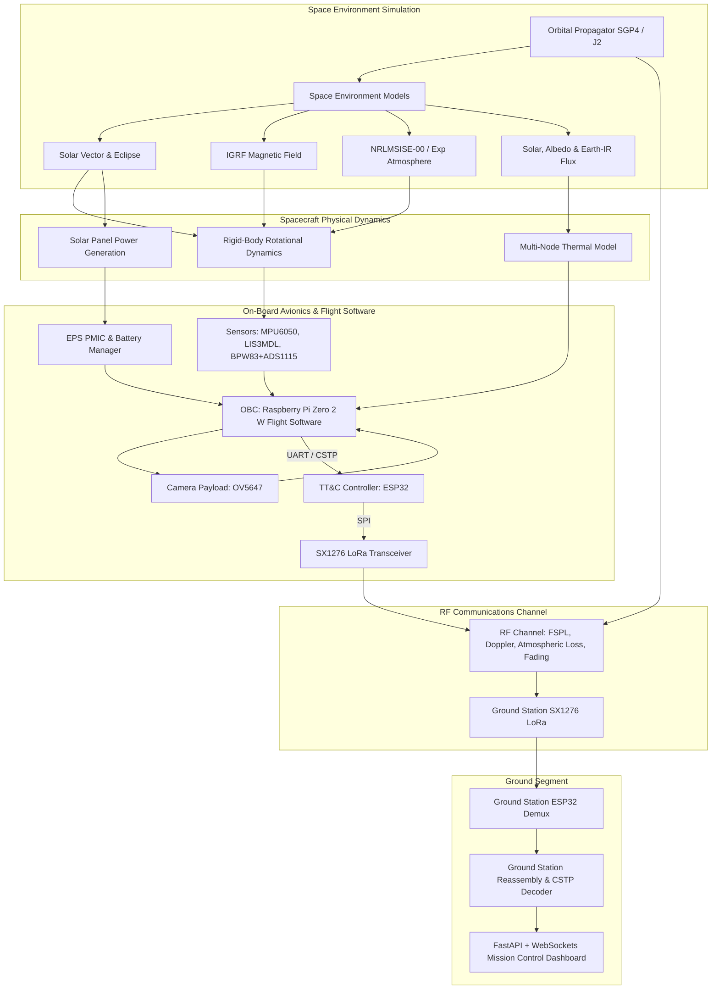

# DOOMSat System Architecture Document (SAD)

**Document ID:** DOOM-SAD-001  
**Revision:** 1.0  
**Status:** Approved Baseline  
**System:** DOOMSat 1U CubeSat Digital Twin & Mission Simulator  

---

## 1. Architectural Principles & System Decomposition

DOOMSat employs a decoupled, modular, model-based architecture. The simulation engine runs in discrete time steps ($\Delta t$) or continuous numerical integration steps, maintaining state vector consistency across all subsystems while preserving clean separation between flight software models, physical environment dynamics, and hardware interfaces.



---

## 2. Subsystem Interface & Module Breakdown

### 2.1 Core Package (`doomsat.core`)
- **`constants.py`:** SI units, CODATA fundamental constants, WGS-84 ellipsoidal parameters, and astrodynamical coefficients.
- **`coordinates.py`:** Standardized coordinate frame transformations:
  - $\text{ECI} \leftrightarrow \text{ECEF}$ (Greenwich Mean Sidereal Time rotation)
  - $\text{ECEF} \leftrightarrow \text{Geodetic}$ (WGS-84 Latitude, Longitude, Altitude)
  - $\text{ECI} \leftrightarrow \text{Orbit LVLH}$ (Radial, In-track, Cross-track)
  - $\text{Body} \leftrightarrow \text{Orbit LVLH}$ (Euler angles, Quaternions, Direction Cosine Matrix)
- **`schemas.py`:** Pydantic dataclasses for immutable state vectors, telemetry frames, and command packets.

### 2.2 Simulation Engine (`doomsat.sim`)
- Master simulation clock ($t_{sim}$), variable step management ($\Delta t = 0.1\text{ s}$ to $1.0\text{ s}$), event scheduler, and state history recording.
- Subsystem update loop order:
  1. Propagate orbit position $\mathbf{r}_{ECI}(t)$ and velocity $\mathbf{v}_{ECI}(t)$.
  2. Compute environmental vectors: Sun position $\mathbf{s}_{ECI}$, eclipse factor $\nu \in [0, 1]$, Earth magnetic field $\mathbf{B}_{ECI}$.
  3. Transform environmental vectors to Spacecraft Body frame using attitude quaternion $\mathbf{q}(t)$.
  4. Evaluate external disturbance torques ($\boldsymbol{\tau}_{gg}, \boldsymbol{\tau}_{mag}, \boldsymbol{\tau}_{aero}, \boldsymbol{\tau}_{srp}$).
  5. Integrate attitude dynamics and kinematics: $\boldsymbol{\omega}(t + \Delta t)$, $\mathbf{q}(t + \Delta t)$.
  6. Compute solar power generation $P_{pv}(t)$, battery state of charge $\text{SoC}(t + \Delta t)$, and bus voltages.
  7. Compute multi-node temperatures $\mathbf{T}(t + \Delta t)$.
  8. Sample sensor models with noise and quantization.
  9. Execute OBC flight software state machine and control laws.
  10. Process TT&C packet buffers and propagate RF link state.

### 2.3 Flight Software Architecture (`doomsat.obc`)
- Modeled after embedded Linux flight software on Raspberry Pi Zero 2 W:
  - Multi-threaded or cooperative async tasks: Telemetry Collector, Health Monitor, Payload Task, Communications Daemon.
  - Finite State Machine (FSM):
    - `BOOT`: Post-ejection stabilization timer ($45\text{ minutes}$ RF silence compliant with deployer rules).
    - `SAFE_HOLD`: Low-power B-dot detumbling, non-essential systems unpowered.
    - `NOMINAL`: Periodic beacon transmission, full sensor polling, battery charging.
    - `SCIENCE_PASS`: Pointing camera nadir, triggering image capture.
    - `DOWNLINK_BURST`: Ground station visible, streaming high-rate CSTP packets.

### 2.4 Communication Stack & CSTP (`doomsat.comms`)
- **Layer 1 (Physical):** Semtech SX1276 LoRa transceiver emulation or physical hardware bridge.
- **Layer 2 (Data Link):** CSTP framing with SLIP byte stuffing (`0xC0`), sequence indexing, and CRC-16-CCITT integrity.
- **Layer 3 (Transport/Network):** Packet fragmentation and reassembly (PFR) for binary image chunks, with selective ACK/NACK retransmissions.

### 2.5 Ground Segment & Mission Dashboard (`doomsat.ground_station` & `doomsat.dashboard`)
- FastAPI asynchronous backend serving REST endpoints and streaming WebSockets.
- Frontend rendering real-time telemetry (telemetry dials, 3D attitude cube, Ground Track map, LoRa SNR/RSSI graphs, and decoded image tiles).

---

## 3. Hardware Decoupling & HIL Design Pattern

To support both pure software simulation and Hardware-in-the-Loop (HIL) testing without modifying flight logic, a Hardware Abstraction Layer (HAL) pattern is used:

```python
class RadioInterface(ABC):
    @abstractmethod
    def send_packet(self, data: bytes) -> bool: ...
    @abstractmethod
    def receive_packet(self) -> Optional[bytes]: ...
    @abstractmethod
    def get_status(self) -> RadioStatus: ...

class SimulatedSX1276(RadioInterface):
    """Pure Python digital twin modeling RF link budget, BER, airtime and fading."""
    ...

class PhysicalESP32SerialRadio(RadioInterface):
    """Direct serial interface (pyserial) to physical ESP32 + SX1276 hardware."""
    ...
```
